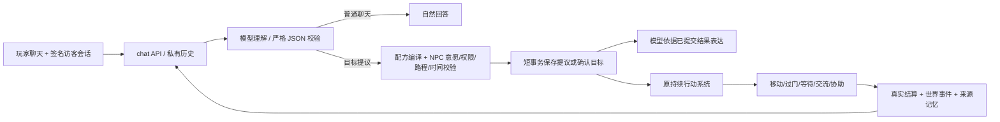

# V11.7：自然语言目标 → 合法计划 → 真实世界

2026-10-10，本地最小链路验收。基线 `de3496a`，保留进入本轮前已有的 README、V11.6 修复、UI 和文档修改；没有提交、推送、部署或初始化主世界。外部付费模型调用 **0 次**。本报告也包含用户随后补充的“地点无关”与 Goal → Plan → Action → World 方向。

## 真实问题与运行版本

- 原 `chat-service.chat` 在模型之前用 `invitationIntent` 的正则白名单分流，`confirmInvitation` 直接返回控制台词；稍换措辞会进入完全不同的链路。
- `buildMessages` 曾要求用户按特定咖啡馆句式邀请。历史台词、待定提议、已确认约定没有共同的语义入口。此前用户“先在广场聊聊”的记录为 `source=ai`，不能笼统归因于 Fallback。
- 开始时3100端口 PID28136（13:08:38启动），页面构建号 `sVuEZEmtqa85tBO6GWdXR`，当时磁盘构建号 `UU61VBUgnrXAAvkiO9u7s`：实际仍是旧进程。既有正常重启尝试被自动审批策略阻止，本轮没有绕过限制杀进程。浏览器验收使用自己启动的 **3139隔离进程**，不是声称3100已经切版。
- 不重建世界引擎：`Action`、`canExecute/execute`、`beginAction/progressAction`、`work.helpTarget`、门户与寻路已经足以组合本轮能力。

## 最小设计与真实调用链



`POST /api/npcs/{id}/chat → chat → naturalChat → modelReply(JSON) → parseUnderstanding → confirmInvitation → compileGoalPlan/assessInvitation → PostgreSQL提交 → modelReply(自然表达) → 私有ChatTurn → 场景气泡`。

世界部分：`wake/tick → updateWorld(行锁) → advanceWorld → appointmentDecision → 原move/enter/exit/walk-inside或nextPlanAction → progressAction → canExecute/execute → settleGoalStep → 同一事务保存世界与约定`。不会在世界行锁内等待模型。NPC回复锁只限制同一个世界中该NPC的并发回复；其他NPC、世界推进不被模型等待阻塞。

### 目标与能力数据

| 配方 | 步骤 | 实际含义 |
|---|---|---|
| meet | travel → wait_for_player | 地点无关会合；到达不等于玩家到场 |
| social | travel → socialize | 与目标地点真实在场居民交流，复用原社交条件 |
| assist | travel → approach-work → help | 协助真实职业任务核对，不等于整份理货工作完成 |

`goal-plan.ts` 只有配方与基础动作分派，没有 Coffee/Library/StoreGoal Handler。`meeting-places.ts` 是地点能力、别名、访问规则与活动锚点数据；坐标从 `positionAt` / `portalSpawn` 获取，路线由原 `roadPath/findScenePath` 生成。住宅只允许居民在自己的家安排；公共建筑和广场经过可通行校验。增加地点主要补充能力/权限数据，不复制移动代码。

单元测试额外编译 `travel → read` 配方，使用同一个执行、前置条件与结算函数。未来开放此类目标只需登记目标类型及配方/地点能力；新增世界根本不存在的动作仍必须实现和验证基础能力，不能交给模型发明。

沿用 `town_invitations` 名字与 `Npc.appointment`，避免并行建任务表或改 API。新增可选 `goal`、`plan {steps,cursor,workerId?,workTaskId?,evidence[]}`，兼容旧记录。执行到场后进入等待玩家或 `executing`；实际步骤结算才移动游标，全部动作成功后 `completed`。取消未结算的静止目标动作会停止，已提交的移动在安全位置结束；工作对象、权限或紧急条件改变时保存失败/等待原因，不重复结算。

### 模型协议与协商

理解阶段只允许两类结果：

```json
{"kind":"chat","reply":"自然对白"}
```

```json
{"kind":"goal","intent":{"goal":"meet","operation":"update","destination":null,"time":{"day":6,"hour":13,"minute":0},"timing":"scheduled","confidence":0.95,"referenceId":"当前访客真实提议的UUID"}}
```

操作为 propose/update/confirm/decline/cancel/status/clarify。地点和目标枚举来自配置；未知字段、地点、目标、无效数字、格式不符全部拒绝解析。低置信度、缺目标/地点/时间会澄清；多轮只继承同一访客的真实提议。明确给出合法时间可由NPC评估后确认；NPC反建议仍须玩家同意。旧日期不偷偷滚到明天。

继续使用已有 fetch 适配层，不增加 SDK/Agent 依赖。使用 OpenAI-compatible `response_format: json_object` 加本地严格校验；JSON模式本身不保证协议有效，依据 [Qwen结构化输出文档](https://www.alibabacloud.com/help/en/model-studio/qwen-structured-output)。普通聊天1次模型请求，目标协商/操作最多2次；每次均消耗现有日额度和并发配额，没有通用重试。

正常模型模式不使用邀请句式白名单来决定语义。有限旧句式保留为无模型/故障降级，不继续扩充它；新目标的自然理解需要模型，本轮用可控替身测试。最终表达读取事务结果；轻量事实检查捕获明显的错地点、未确认承诺、未到达/未完成和错误时间，冲突原文保留在私人诊断。它不是完整的语义证明器。

## 三个目标的端到端结果

主证据：`web/evidence/v11-7/goals-eb04ae0b-788a-4be7-a12e-7220368a2a18/result.json`。13个独立测试世界，50次**本机HTTP替身**请求，外部0次。请求、模型结构化结果、实际持久化约定、动作ID及世界快照均在记录中；不是让前端演一段动画。

1. **咖啡馆会面**：第一轮产生未确认提议；“午后一点”继承cafe，在同一ID上确认13:00。阿晴沿原路径与入口进入 `cafe_interior`，12:56到达等待；另一访客不能确认会面；原访客同场景合法近距离出现后才 `met`。重复请求不再调模型、不产生第二份任务。
2. **广场交流**：从真实咖啡馆室内测试状态出发，经出口和室外路线到square，随后完成 `socialize`，状态 `completed`，保留实际动作ID。没有制造NPC说出的台词，也不声称玩家到场。另有 meet/square、meet/library 完整到达与近距离会面测试，复用同一流程。
3. **商店协助**：小满有原系统中的协助资格，老林在真实工作点、任务 `fixture-shelves` 进行中。小满从商店入口走到 `(640,340)` 协助点，实际完成 approach-work、help；12:24记录有来源的共同工作经历和关系变化。记录明确写“任务尚未完成，不发放产出”，没有把帮助核对变成整体完工。安静、无资格居民的同类请求被拒绝。

同时验证：疲劳拒绝、赶不及时间的反建议与确认、地点修改、跨天日期、取消、其他访客伪造referenceId、无效地点、歧义输入、8种普通聊天零约定、模型故障和约1.2秒超时、表达阶段失败仍保留已确认目标；模型等待时世界推进成功，同NPC另一请求409。

私人目标事件进入原 `retrievePlayerFacts`（世界/NPC/访客三重隔离），保留源约定、确认消息、时间及实际动作结果。公共世界只记录公开行动，不附访客身份或私聊原文。工作关系变化仍由原 `settleWork/recordExperience` 产生，不因接受提议自动涨好感。

## 回归、恢复与浏览器

执行目录均为 `web/`，数据库55488。未改主库55487、地图资源、密钥或参考仓库。

| 命令/检查 | 实测结果 |
|---|---|
| `npm run typecheck` / `npm run lint` | 通过 |
| `npm test` | 32文件、179测试通过 |
| `npm run build` | Next.js生产构建通过 |
| `node --env-file=.env.test.local --import tsx scripts/goal-check.ts` | 上述13世界目标链路通过 |
| 同形式 `scripts/invitation-negotiation-check.ts` | 原10世界多轮/Fallback回归通过；证据 `negotiation-8e0ac751-ba71-43b5-b350-d612b32788ba` |
| 同形式 `scripts/v11-6-check.ts` | 姓名、换场景、跨天、20轮淘汰、称呼更正、隐私和定时约定通过；证据 `v11-6-aff8ef81-e449-4e4c-b5ae-9906464cb7bf` |
| 同形式 `scripts/v12-story-check.ts` | 原公共活动、实际参与与来源记忆故事通过；证据 `v12-story-cd88679c-db6c-42db-9e35-19985f177946` |
| 同形式 `scripts/goal-concurrency-check.ts` | 6组数据库并发回归通过；8个到期唤醒只走一步，手动/送食物竞态一致 |
| `STORY_RESULT=上述目标result.json`，运行 `scripts/goal-recovery-check.ts --restart-test-postgres` | 验证容器确为55488和专用测试卷后实际重启；13世界、12约定、14私聊完整一致，途中动作续接通过；证据 `recovery-aa23dddd-2b26-445a-a173-92a202fe4f7d` |
| `node --env-file=.env.test.local --import tsx scripts/goal-browser.mjs --polite` | Chromium真实页面、E交互、协商、自动路径、暂停、测试应用重启、玩家步行进门、实际会面、另一浏览器私聊隔离通过；页面错误0 |

保留了暴露的问题：旧V10并发脚本断言“推进后仍然正在socialize”不适合当前连续行动/社交时序；新并发脚本比较干预前后的真实决策，再保留全部事务竞态断言。旧姓名Mock适配新JSON信封并按标识定位世界事实，不降低原姓名断言。旧上下文测试曾把arrived命名成completedMeeting，已拆为arrival与真正met，避免用到达冒充见面。首次浏览器脚本因“见过面”不匹配“见面”断言失败，修正后完整重跑通过。旧证据与失败截图均保留。

浏览器证据目录：`web/evidence/v11-7/goal-browser-650ae0d4-d6d8-422c-9136-d69c2e977641/`：

- `01-cafe-negotiation.png`：自然措辞的未确认提议。
- `02-confirmed-cafe-time.png`：后台确认时间后回复。
- `04-real-route.png`：自动运行中的真实路径。
- `05-restart-preserved.png`：测试服务重启恢复。
- `06-real-meeting.png`：玩家进门靠近后实际会面。
- `07-persisted-history.png`：私人完整记录。
- `journey.webm`：连续运行录像；`result.json` 区分本地模型替身与后台事实。

## 修改范围与限制

新增核心文件：`goal-plan.ts`、`meeting-places.ts`、`meeting-language.ts`、`natural-chat.ts`。修改 `chat-service/model/context/facts/types`、`appointments`、`invitation-store`、`world`；ChatDialog允许所有合法会面场景提交presence，并仅在诊断模式显示结构化过程。没有数据库建表迁移；新增字段可选，旧无plan记录沿原逻辑恢复。

新增 `goal-plan.test.ts` 和 `goal-check/goal-browser/goal-recovery-check/goal-concurrency-check` 验收脚本，更新姓名Mock和到达/会面上下文测试。增量更新本报告、语义清单、spec、AGENTS、web README。其余开始时已有修改没有清理或代提交。

- **真实Qwen自然语言泛化仍未验证**。本地替身不代表模型能理解任意说法。24条陌生措辞与不应触发动作的清单、最多32次真实调用计划见 [语义复测清单](v11-7-semantic-cases.md)，需新授权。
- 不支持自由巡游、跟随玩家、交易、搬运及任意数据库操作；没有合法工作或权限时不能协助。新地点进入不等于自动获得新能力。
- 计划为短的顺序配方，不是任意组合搜索器；工作目标在途中消失可以失败，保留原因，不假装成功。旅行沿已存在的离散行动边界执行。
- 会面presence仍由客户端报送并校验碰撞/距离，沿用本地玩家方案，不是防作弊的多人权威玩家服务器。
- 不宣称模型回复百分之百事实一致；本轮只提供权威结果、严格执行边界及有限冲突拦截。完整原文和结构化过程留在私有历史与诊断。
- 3100主页面未被本轮切版；应由用户正常关闭原项目服务后，在 `web/` 执行 `npm run start` 并刷新。无需重新初始化数据库。独立测试进程已经关闭。

完成最小目标链路后停止，不扩地图、不增加居民/职业，不部署或追加付费模型测试。
